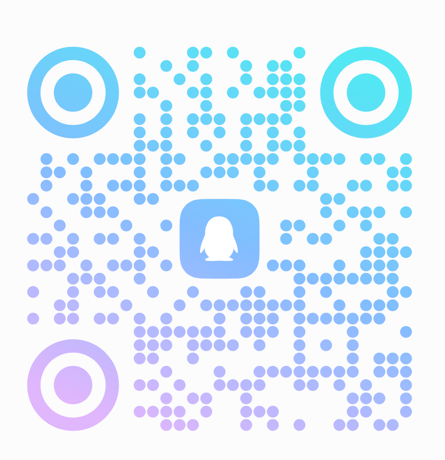

# 陆祺智控 · 集中监控平台

**luche Plant SCADA — Web-based Video + SCADA Integration Platform**

浏览器端的「视频监控 + 组态 SCADA + 时序数据库」一体化工业监控平台。面向泵站、水厂、变电站等多站点无人值守场景，替代 WinCC / KingSCADA 这类传统上位机。

**中文** ｜ [English](#english)

---

# 中文

## 这是什么

一套跑在浏览器里的工业监控平台。PLC 数据采集、组态画面、历史曲线、报警、视频监控，全部通过浏览器完成，不需要在每台操作员电脑上装客户端。

设计目标是「200 个站点、每站 1 台 PLC × 1000 点、每站 2 路摄像头」这种规模：20 万点位、400 路视频、10 人同时看数据、20 路同时预览。

## 核心能力

| 模块 | 说明 |
|---|---|
| **组态编辑器** | 拖拽式画布，35 种图元（标准图形 8 / 智能对象 4 / 工艺图元 12 / 大屏组件 5 / 数据控件 6），画布尺寸与显示比例任意可调 |
| **条件规则** | 每个图元可挂多条「当前值 = x → 执行动作」规则，6 种比较条件 × 6 种动作（填充色/边框色/文字色/输出文字/显示隐藏/闪烁） |
| **动态化** | 变量绑定、区间映射、数值按数据类型格式化（bool 显示 0/1、整数无小数、浮点按小数位） |
| **实时刷新** | PLC → 网关 → Redis → SSE → 浏览器 250ms tick，端到端延迟 = 采集周期 + 0.5 秒 |
| **历史数据** | TDengine 时序库，点位级入库间隔，库级保留期（自动清理），按天/时区间查询与 CSV 导出 |
| **报警** | 上限/下限/死区/回差，报警窗支持多变量过滤、时间区间过滤、确认与恢复 |
| **视频监控** | RTSP → ZLMediaKit → flv.js，组态画面内嵌视频窗，按需拉流，无人观看 60 秒自动回收 |
| **多网关** | 分散部署采集网关，每个网关管自己那几个站点，平台侧统一管理 |
| **点位管理** | CSV/Excel 批量导入导出、冲突按行选择覆盖或忽略、导入问题不阻断并记录到「错误提示」列 |
| **数据库运维** | 只读查询（点位/报警/历史/日志）、MySQL 备份下载、TDengine 保留期设置与到期提醒 |

## 技术栈

```
前端     Vue 3 + Element Plus + Vite + ECharts + flv.js
后端     FastAPI + SQLAlchemy + PyMySQL + python-jose
网关     FastAPI + python-snap7 / pymodbus / pymcprotocol / asyncua / fins-driver
时序库   TDengine 3.x（REST 接口）
关系库   MySQL 8
缓存     Redis 7（实时值 + SSE 变更流）
视频     ZLMediaKit（RTSP 转 HTTP-FLV）
部署     Docker Compose + Nginx（唯一入口）
```

## 架构

```
   ┌──────────┐   ┌──────────┐   ┌──────────┐
   │ 工作站1  │   │ 工作站2  │   │ 大屏     │   浏览器
   └────┬─────┘   └────┬─────┘   └────┬─────┘
        └──────────────┼──────────────┘
                       │  HTTP / SSE
                  ┌────┴─────┐
                  │  Nginx   │  唯一入口
                  └────┬─────┘
        ┌──────────────┼──────────────┐
        │              │              │
   ┌────┴────┐   ┌─────┴─────┐  ┌─────┴─────┐
   │ backend │   │ gateway-1 │  │ gateway-N │   采集网关
   └────┬────┘   └─────┬─────┘  └─────┬─────┘
        │              │              │
   ┌────┴────┬─────┐   │ S7 / MC /    │
   │  MySQL  │Redis│   │ Modbus /     │
   └─────────┴─────┘   │ OPC UA /FINS │
   ┌─────────────┐     │              │
   │  TDengine   │◄────┘              ▼
   └─────────────┘              ┌──────────┐
                                │  PLC × N │
                                └──────────┘
```

关键设计：

- **实时不做同步做共享** —— 网关把自己采到的值写进 Redis，多个网关、多个后端实例共享同一份，不互相推送
- **S7 单连接严格串行** —— S7comm 是一问一答协议，采集和写入必须按站点串行（`io_lock`），否则响应错序报 Stale packet
- **心跳独立于采集** —— 心跳是采集的前提，挂在独立常驻任务里；没配心跳的站点永不采集，心跳离线的站点停采等恢复
- **视频按需拉流** —— 只有画面里的视频窗被打开时才向 NVR 拉流，关闭 60 秒后回收，避免 400 路视频压垮带宽

## 快速开始

```bash
# 1. 准备环境变量
cp .env.example .env
vi .env            # 填 MySQL / TDengine 密码，改 JWT_SECRET

# 2. 启动
docker compose up -d

# 3. 打开浏览器
#    http://<服务器IP>/
#    默认管理员账号见 .env 里的 ADMIN_USER / ADMIN_PWD
```

详细部署步骤见 `docs/部署手册.md`，组态操作见 `docs/组态操作手册.md`。

## 支持的 PLC 协议

| 协议 | 支持型号 | 说明 |
|---|---|---|
| **S7 (S7comm)** | S7-200 SMART / 1200 / 1500 / 300 / 400 | 支持 OP / PG / S7basic 三种连接类型，TSAP 可手填 |
| **三菱 MC** | FX3U / FX3G（需 FX3U-ENET-ADP）/ FX5U / Q / L / iQ-R | **FX3U 挂 ADP 只认 A 兼容 1E 帧**，收到 3E 帧不报错直接把数据读成 0，这个坑实测踩过 |
| **Modbus TCP / RTU** | 通用 | 保持寄存器 / 线圈 / 输入寄存器 / 离散输入 |
| **OPC UA** | 通用 | 通过 asyncua |
| **欧姆龙 FINS** | 通用 | CIO / D / W / A / T / C 区 |

地址写法遵循各品牌原编程软件习惯：`VD1000` / `V1000.3` / `DB1.DBW0`（西门子）、`D1018` / `M100` / `X10`（三菱）。注意：**S7-200 SMART 的 V 区是字节寻址，`VD5517` 就是 `VB5517~VB5520`，不要求 4 字节对齐**。

## 社区版额度

| 项 | 上限 |
|---|---|
| 每网关 PLC 台数 | **2 台** |
| 每台 PLC 采集点 | **1000 个** |
| 平台视频通道 | **8 路** |

额度集中在 `shared/edition.py` 一个文件里。超出额度需要商业授权，见下方联系方式。

## 许可证

**GNU Affero General Public License v3.0（AGPL-3.0）** —— 见 [LICENSE](LICENSE)。

你可以自由使用、修改、分发本项目。如果你修改后通过网络对外提供服务（SaaS），
需要把修改后的源码同样以 AGPL-3.0 开放。

如需闭源商业使用（例如接入超过社区版额度、或用本项目为客户交付但不开放源码），
请联系我们获取商业授权。

第三方组件许可证见 [THIRD-PARTY-NOTICES.md](THIRD-PARTY-NOTICES.md)。

## 联系

张家口陆祺智控工程技术有限责任公司

技术交流 / 问题反馈，扫码加入 QQ 群：



---

# English

## What is this

A browser-based industrial monitoring platform that combines **SCADA configuration, PLC data acquisition, time-series history, alarming and video surveillance** in a single web application. Built for unattended multi-site scenarios — pump stations, water treatment plants, substations — as a replacement for traditional HMI/SCADA desktop software such as WinCC or KingSCADA.

Designed and tested at the scale of **200 sites × 1,000 tags per PLC × 2 cameras per site** — 200k tags, 400 video channels, 10 concurrent data viewers, 20 concurrent video previews.

## Key features

| Module | Description |
|---|---|
| **SCADA editor** | Drag-and-drop canvas with 35 element types (8 standard shapes / 4 smart objects / 12 process symbols / 5 dashboard widgets / 6 data controls). Canvas size and zoom are fully configurable. |
| **Rule engine** | Any element can carry multiple "if value = x then action" rules. 6 comparison operators × 6 actions (fill / stroke / font color, text overlay, visibility, blink). |
| **Dynamic binding** | Tag binding with range mapping; values formatted by data type (bool as 0/1, integers without decimals, floats to configured precision). |
| **Live refresh** | PLC → gateway → Redis → SSE → browser at a 250 ms tick. End-to-end latency ≈ poll interval + 0.5 s. |
| **History** | TDengine time-series storage, per-tag storage interval, database-level retention with automatic eviction, range queries and CSV export. |
| **Alarming** | Hi/Lo limits, deadband, hysteresis. Alarm viewer supports tag filtering, time-window filtering, acknowledge and clear. |
| **Video** | RTSP → ZLMediaKit → flv.js. Video windows embedded in SCADA pages, streams pulled on demand and released after 60 s of inactivity. |
| **Multi-gateway** | Distributed acquisition gateways, each owning its own set of sites, managed centrally. |
| **Tag management** | CSV/Excel bulk import and export, per-row conflict handling (overwrite / ignore), import errors never block the import and are recorded in an "error hint" column. |
| **Maintenance** | Read-only database browser, MySQL backup download, TDengine retention configuration with expiry reminders. |

## Tech stack

```
Frontend   Vue 3 + Element Plus + Vite + ECharts + flv.js
Backend    FastAPI + SQLAlchemy + PyMySQL + python-jose
Gateway    FastAPI + python-snap7 / pymodbus / pymcprotocol / asyncua / fins-driver
TSDB       TDengine 3.x (REST)
RDBMS      MySQL 8
Cache      Redis 7 (live values + SSE change stream)
Video      ZLMediaKit (RTSP → HTTP-FLV)
Deploy     Docker Compose + Nginx (single entry point)
```

## Design notes

- **Share, don't sync** — gateways write acquired values into Redis; multiple gateways and backend replicas read the same data instead of pushing to each other.
- **Strict serialization on S7** — S7comm is a request/response protocol on a single connection. Acquisition and writes are serialized per site (`io_lock`); concurrent requests cause out-of-order responses and `Stale packet` errors.
- **Heartbeat is independent of acquisition** — heartbeat runs as a dedicated resident task and is a *precondition* for acquisition. Sites without a heartbeat configuration are never polled; sites with an offline heartbeat stop polling until it recovers.
- **Video pulled on demand** — streams are pulled only while a video window is open and released 60 seconds after it closes, so 400 channels do not saturate the network.

## Quick start

```bash
# 1. Prepare environment
cp .env.example .env
vi .env            # set MySQL / TDengine passwords, change JWT_SECRET

# 2. Start
docker compose up -d

# 3. Open in a browser
#    http://<your-server-ip>/
#    default admin credentials are in .env (ADMIN_USER / ADMIN_PWD)
```

See `docs/部署手册.md` for deployment details and `docs/组态操作手册.md` for the SCADA editor guide.

## Supported PLC protocols

| Protocol | Models | Notes |
|---|---|---|
| **S7 (S7comm)** | S7-200 SMART / 1200 / 1500 / 300 / 400 | OP / PG / S7basic connection types, manual TSAP override |
| **Mitsubishi MC** | FX3U / FX3G (via FX3U-ENET-ADP) / FX5U / Q / L / iQ-R | **FX3U with an ADP only accepts the A-compatible 1E frame** — it silently returns 0 when sent a 3E frame instead of raising an error |
| **Modbus TCP / RTU** | Generic | Holding registers, coils, input registers, discrete inputs |
| **OPC UA** | Generic | via asyncua |
| **Omron FINS** | Generic | CIO / D / W / A / T / C areas |

Addresses follow each vendor's native programming convention: `VD1000` / `V1000.3` / `DB1.DBW0` (Siemens), `D1018` / `M100` / `X10` (Mitsubishi). Note that **the S7-200 SMART V area is byte-addressed: `VD5517` occupies `VB5517`–`VB5520` and does not require 4-byte alignment**.

## Community edition limits

| Item | Limit |
|---|---|
| PLCs per gateway | **2** |
| Tags per PLC | **1,000** |
| Video channels per platform | **8** |

All limits live in a single file, `shared/edition.py`. Exceeding them requires a commercial license — see contact details below.

## License

**GNU Affero General Public License v3.0 (AGPL-3.0)** — see [LICENSE](LICENSE).

You are free to use, modify and distribute this project. If you modify it and
make it available to users over a network (SaaS), you must release your
modified source under AGPL-3.0 as well.

For closed-source commercial use (e.g. exceeding the community limits, or
delivering this platform to customers without open-sourcing your changes),
please contact us for a commercial license.

Third-party component licenses are listed in [THIRD-PARTY-NOTICES.md](THIRD-PARTY-NOTICES.md).

## Contact

Zhangjiakou Luche Intelligent Control Engineering Technology Co., Ltd.

Technical discussion / issue reporting — scan to join our QQ group:


